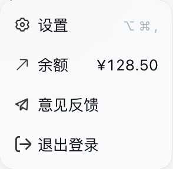
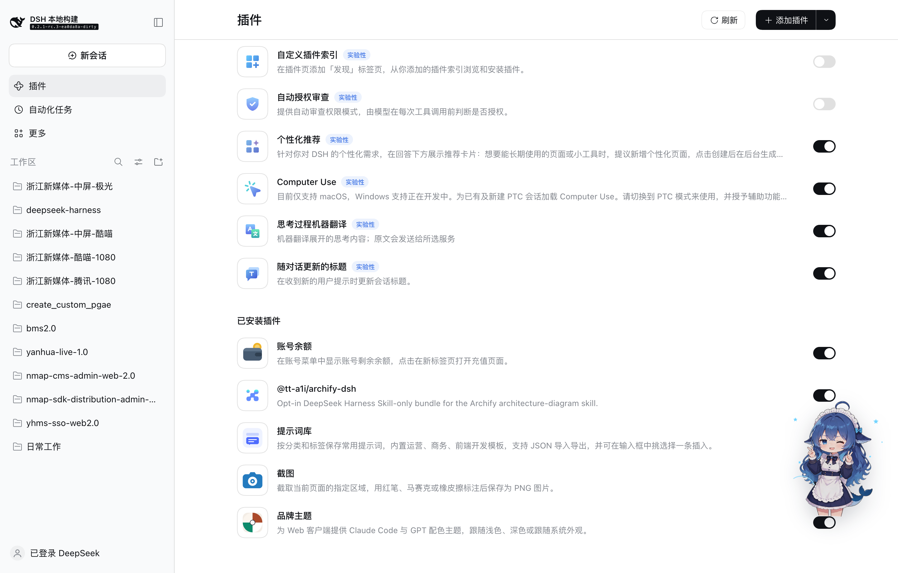

# Account balance

Browser plugin for DeepSeek Harness that shows the remaining account balance in the sidebar account menu and opens the top-up page in a new tab.

## Behavior

When the account is signed in, the sidebar account menu shows a **Balance** row between the Settings and Feedback rows. Its right side shows the topped-up balance, or an em dash while the read is pending or unavailable. Selecting the row closes the menu and opens the Platform top-up page in a new tab; the row is disabled until the account reports a top-up destination. A signed-out account menu renders no row.

The row registers into the account menu's `settings.launcher.menu.item` list slot, which the shipped account plugin declares; the client half waits for that declaration instead of requiring the account package.

## Install and remove

The package is a bundle: `cordis.patch.yml` inserts the `dsh-account-balance` Loader row, and `dsh.client` in `package.json` serves `client.js` to the page.

- Install from this directory with the `plugin_manager` tool (`install_bundle`, absolute path).
- Remove with `plugin_manager` (`remove_bundle`, `@local/dsh-account-balance`).

## Screenshots

The row sits between Settings and Feedback, with the balance right-aligned:

The installed bundle in the Plugins page keeps its wallet artwork, localized title, and description:

## Verification limits

The amount comes from the shipped account feature's own Platform read and its Platform Web currency formatting; the row itself renders no value. A failed or pending read therefore shows an em dash rather than a fabricated zero, and the row still opens the top-up page once the account reports a destination.

The screenshots were captured from a local verification instance whose account reads were served by a mock Platform origin, so the displayed identity is mock data; the row, placement, and navigation are the reviewed behavior.
