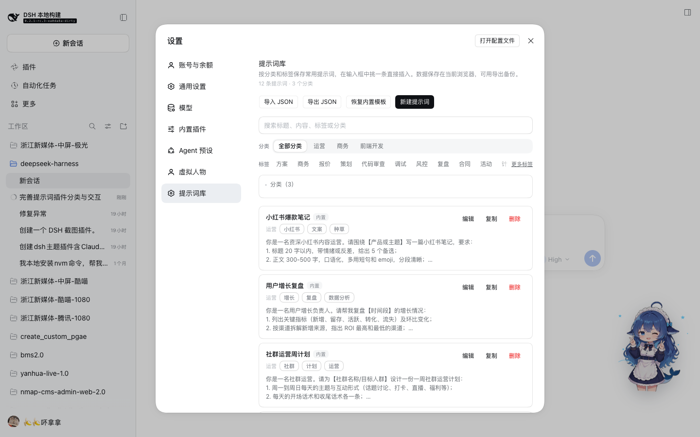
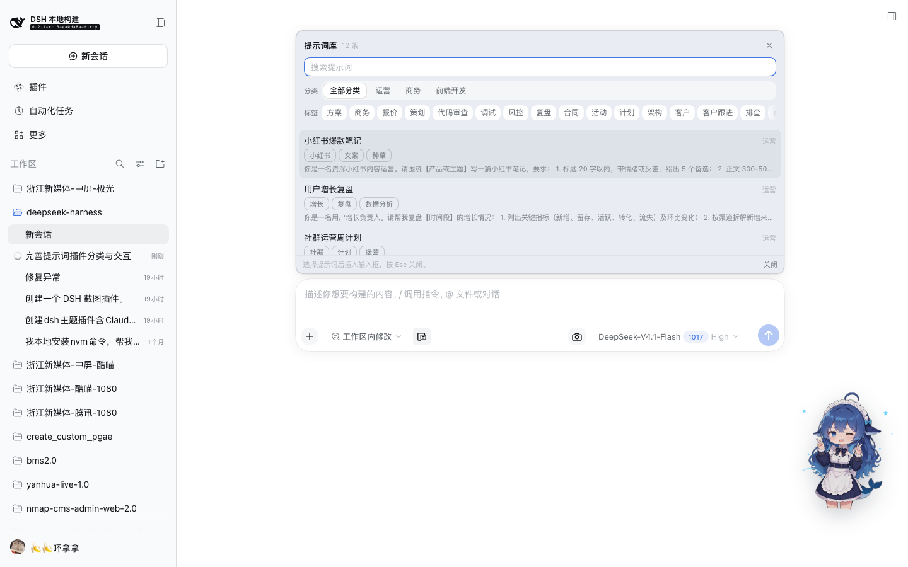
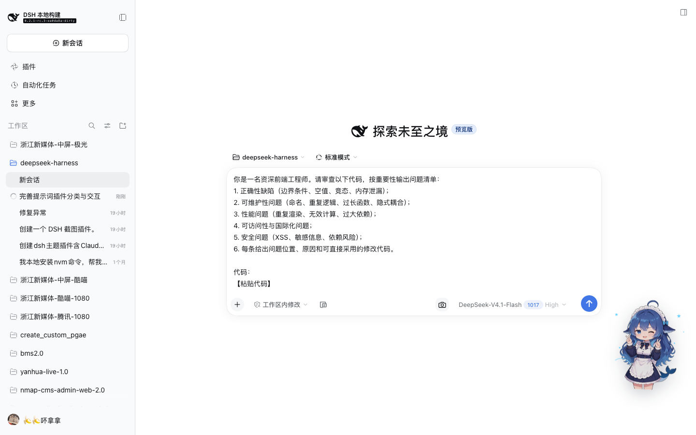

# Prompt library（提示词库）

DeepSeek Harness Web 客户端的提示词管理插件：在「设置」里维护一套常用提示词，按自定义分类和标签组织，在输入框工具栏一键挑一条插入草稿。适合把「项目背景」「运营话术」「代码审查要求」这类反复使用的提示词沉淀下来。

## 功能

- **提示词管理页（设置 → 提示词库）**
  - 新建、编辑、复制、删除提示词；标题 + 内容 + 分类 + 标签。
  - 按关键词搜索（标题、内容、标签、分类）；分类用分段标签页筛选，标签用胶囊筛选。
  - **分类可自定义**：新增、重命名、删除；删除分类时其提示词自动移到「未分类」。
  - **标签**：每条提示词自由打标签，管理页与选择器都会聚合出标签清单供筛选。
  - **内置模板**：首次加载自动写入运营、商务、前端开发三个分类共 12 条模板；删掉后可用「恢复内置模板」补回缺失项（不会重复、不会覆盖你改过的内容）。
  - **导入 / 导出 JSON**：导出整库为 JSON 文件；导入时按分类名合并、按「标题 + 内容」去重，并报告导入/跳过数量。
- **输入框选择器**
  - 输入框工具行左侧的提示词图标按钮（28×28 幽灵按钮，18px 图标，悬停高亮）打开面板；面板为实色办公风格卡片，带标题与结果计数、搜索框、分类标签页和标签胶囊筛选，支持 ↑/↓ 选择、Enter 插入、Esc 或右上角 × 关闭。
  - **分类与标签分层展示**：分类用分段标签页（「分类」），标签用可点选胶囊（「标签」），不再混在一起；提示词卡片上的标签使用宿主的 Tag 胶囊样式。
  - 插入为普通文本（一次撤销步），不会替换你已经写好的草稿；草稿非空时自动以空行分隔，插入后焦点回到输入框。
- **双语界面**：跟随 Harness 语言（中文 / English）。

## 预览

| 设置 → 提示词库 | 输入框选择器 |
| --- | --- |
|  |  |



## 数据与持久化

- 数据保存在当前浏览器的 `localStorage`，键为 `@local/dsh-prompt-library:library.v1`，刷新、重启后仍在；同一浏览器的多个标签页会互相同步。
- 由于保存在浏览器本地，**换浏览器、换设备或清理站点数据前请先「导出 JSON」备份**，需要时再导入。
- 导入文件格式（导出的同款）：

```json
{
  "format": "dsh-prompt-library",
  "version": 1,
  "exportedAt": "2026-10-26T08:00:00.000Z",
  "categories": [{ "id": "operations", "name": "运营" }],
  "prompts": [
    {
      "title": "小红书爆款笔记",
      "content": "……",
      "categoryId": "operations",
      "categoryName": "运营",
      "tags": ["小红书", "文案"]
    }
  ]
}
```

导入时优先按 `categoryName` 匹配已有分类（找不到就新建），再退回 `categoryId`；重复项（标题与内容都相同）会跳过。

## 安装与移除

插件以 bundle 形式提供：`cordis.patch.yml` 插入 Loader 行，`package.json` 的 `dsh.client` 把 `client.js` 提供给页面。

- 安装：`plugin_manager` 工具 `install_bundle`（目标为本目录绝对路径），或 `dsh plugin --profile <profile> add ./plugins/dsh-prompt-library`。
- 移除：`plugin_manager` `remove_bundle`，目标 `@local/dsh-prompt-library`。
- 修改 `client.js` 后需在插件页关闭再开启该 bundle（或重启 Host）并刷新页面，浏览器才会加载新的模块代际。

## 实现

- `client.js` 是懒加载 CJS 工厂格式（`window.__ModuleLoader__.load`），只依赖平台模块表中的 `react`；样式全部使用 `--dsw-*` 主题 token，组件按宿主交互模式自绘（未引入 `ui-primitives` 运行时依赖）。
- 注册点：
  - `settings.section`：管理页；
  - `conversation.input.left`：工具行按钮；
  - `conversation.input.overlay`：选择面板（锚定在输入卡片上方）。
- 插入走会话槽位标准能力 `inputActions.captureInsertion()` + `insertText()`，取不到插入范围时退回 `setDraft()`；焦点恢复通过 `ctx.conversation.input.for(sessionScope).focus()`。
- 所有读写都经过校验：`localStorage` 与导入文件在边界处规范化（补 id、去重标签、丢弃无效分类引用），坏数据不会让页面崩溃。
- `index.js` 是空实现的 Host 半部分；bundle 需要一个可加载的 Host 入口。

## 已知限制

- 提示词库按浏览器保存，不跨设备同步（用导入/导出迁移）。
- 管理页在「设置」弹层内，暂不支持直接在管理页把提示词发进某个会话；插入入口在输入框。
- 不支持拖拽排序；提示词按创建顺序展示，分类按创建顺序展示。
