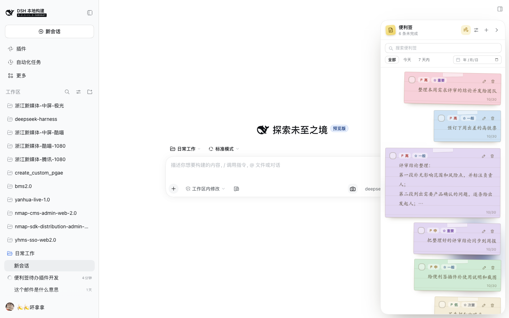
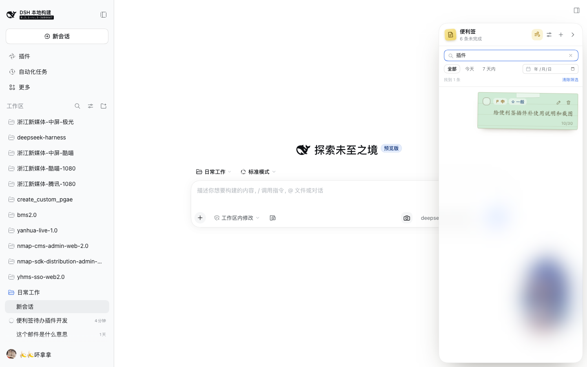
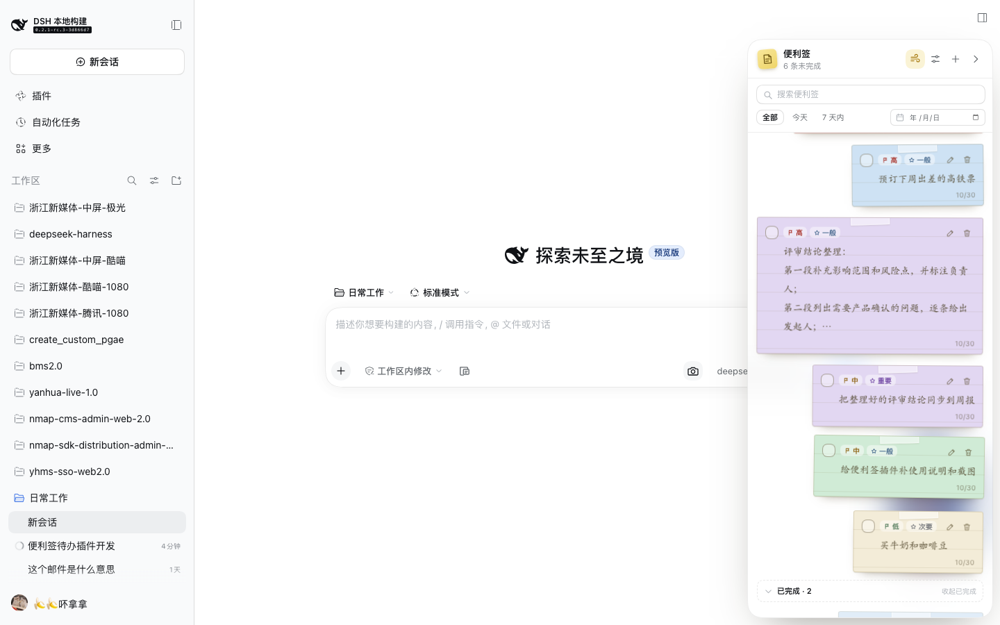
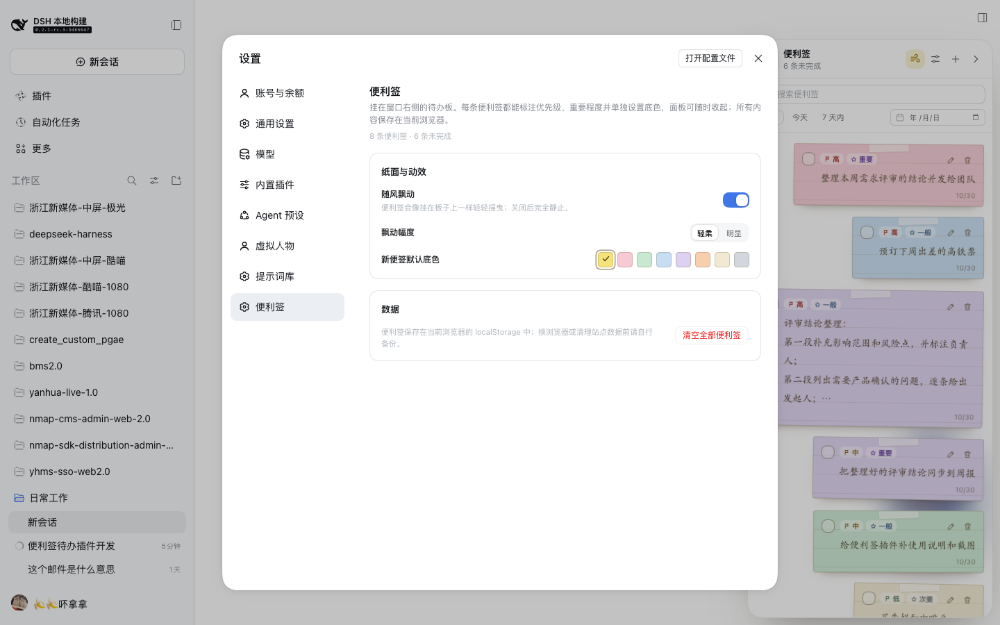

# 便利签（Sticky notes）

DeepSeek Harness Web 客户端的右侧便利签待办插件：在窗口右边缘挂一块可收起的玻璃浮层便利签板，记录待办、标注优先级和重要程度、给每条便签单独挑纸色，按关键字或日期查找，已完成的便利签自动收进归档；所有便利签会随风一起轻轻飘动——飘动效果可以在「设置 → 便利签」里关闭。

| 右侧便利签板 | 关键字 / 日期筛选 | 已完成归档 | 设置 → 便利签 |
| --- | --- | --- | --- |
|  |  |  |  |

## 功能

- **右侧便利签板**
  - 固定在窗口右侧、会话区上方的浮层，不占用布局宽度；顶部与右上角保持安全距离，不遮挡会话标题栏和右侧栏按钮。
  - 面板本身**背景透明**：不铺实色底色，只保留 `backdrop-filter` 毛玻璃模糊和一圈细边框，背后的会话内容会被虚化而不是被一块容器挡住。
  - 点右上角「收起」折成右边缘的一枚竖排便利签标签；标签上显示未完成数量，点击即可重新展开。收起状态会被记住，刷新后仍然是收起的。
  - 面板头部：新建、飘动开关（快捷）、设置、收起；未完成数量实时显示。
- **查找便利签**
  - **关键字搜索**：按标题/正文实时过滤，显示「找到 N 条」，一键清除。
  - **按日期筛选**：`全部` / `今天` / `7 天内` 三个快捷筛选，外加日期选择器可精确到某一天（按便利签的创建日期）。
  - 关键字与日期可以叠加使用；没有匹配结果时显示专门的空状态和「清除筛选」。
  - 每条便利签右下角显示自己的创建日期（归档后显示完成日期），方便按日期回忆和查找。
- **每条待办**
  - 文本支持多行，编辑时自动聚焦；`⌘/Ctrl + Enter` 保存，`Esc` 取消。
  - **优先级**：高 / 中 / 低（旗帜图标）；**重要程度**：重要 / 一般 / 次要（星形图标）。两枚小徽章始终显示在便签顶部。
  - **便签纸色**：8 种纸色（经典黄为默认）+ 任意自定义颜色，每条便签单独保存自己的纸色。
  - **靠右排列且长度随文字自适应**：便利签统一贴齐面板右侧，短文本的便签更窄，长文本的便签变宽，最宽不超过屏幕宽度的 **1/4**（也不会超出面板），到上限后自动换行；高度也随换行后的内容变化，最高 1/4 屏，文字超过 **5 行**时自动截断并显示省略号（鼠标悬停可看完整文字）。
  - 勾选完成、编辑、删除（卡片和编辑态里的删除都需要第二次点击确认）。
- **已完成归档**
  - 勾选完成后，便利签从待办列表移入底部「已完成 · N」归档区，默认折叠；展开后按完成时间倒序查看，也可以取消完成把便签放回待办。
  - 归档的展开/折叠状态会被记住。
- **风吹飘动**
  - 所有便利签共用同一个风周期（相同的时长与相位），待办多的时候整板便签会**一起**轻轻摇曳；每张便签保留自己的稳定倾角，看起来仍然自然。
  - 默认幅度比早期版本更大（轻柔约 1.35°，明显约 2.8°），鼠标悬停时暂停摆动，方便阅读。
  - 可在面板设置浮层或「设置 → 便利签」里随时开关，并可选「轻柔 / 明显」两档摆幅；开启 `prefers-reduced-motion` 的系统会自动静止。
- **设置页（设置 → 便利签）**
  - 开关随风飘动、选择飘动幅度、选择新便签默认底色；
  - 查看便签总数 / 未完成数量；
  - 清空全部便利签（两次点击确认）。
- **双语界面**：跟随 Harness 语言（中文 / English）。

## 安装与移除

插件以 bundle 形式提供：`cordis.patch.yml` 插入 Loader 行，`package.json` 的 `dsh.client` 把 `client.js` 提供给页面。

- 安装：`plugin_manager` 工具 `install_bundle`（目标为本目录绝对路径），或 `dsh plugin --profile <profile> add /Users/jiangjie/日常工作/dsh-sticky-notes`。
- 移除：`plugin_manager` `remove_bundle`，目标 `@local/dsh-sticky-notes`。
- 修改 `client.js` 后需在插件页关闭再开启该 bundle（或重启 Host）并刷新页面，浏览器才会加载新的模块代际。

## 数据与持久化

- 数据保存在当前浏览器的 `localStorage`，键为 `@local/dsh-sticky-notes:board.v1`，刷新、重启后仍在；同一浏览器的多个标签页会互相同步。
- 保存在浏览器本地，**不跨设备同步**；换浏览器、换设备或清理站点数据前请自行备份（可在浏览器开发者工具里复制该键的值）。
- 读取时会校验并规范化数据：缺少字段、非法优先级、无效颜色引用、重复 id、无效的设置值都会被修正或丢弃，坏数据不会让页面崩溃。

## 实现

- `client.js` 是懒加载 CJS 工厂格式（`window.__ModuleLoader__.load`），只依赖平台模块表中的 `react`；样式使用 `--dsw-*` 主题 token（便签纸色是插件自有数据，用 CSS 变量叠加）。
- 注册点：
  - `shell.overlay`：右侧便利签板 / 收起标签（根作用域，不绑定会话，所有会话共用一块板）；
  - `settings.section`：设置页。
- 共享一份浏览器本地 store（`useSyncExternalStore`），两处界面与跨标签页 `storage` 事件同步；所有写入都先经过规范化。
- 筛选、搜索与归档展开状态分别由本地状态和 board 的 `ui.archiveOpen` 持久化；飘动使用一个板级 CSS 变量风周期，所有便签共享。
- `index.js` 是空实现的 Host 半部分；bundle 需要一个可加载的 Host 入口。

## 已知限制

- 便签按浏览器保存，不跨设备同步。
- 面板背景透明、依赖毛玻璃模糊，在非常花哨的会话背景上控件对比度会略降；便签文字超过 5 行只显示省略版，完整内容需悬停或点开编辑查看。
- 便利签板浮在会话区右侧：当右侧栏（文件/终端等）展开时会盖住右侧栏的一部分，可先收起便利签再使用右侧栏。
- 日期筛选按便利签的**创建日期**匹配；关键字只匹配正文，不匹配优先级/重要程度文字。
- 不支持拖拽排序与提醒/到期时间；未完成便利签固定按「优先级 → 重要程度 → 新建时间」排序，已完成按「完成时间」倒序归档。
