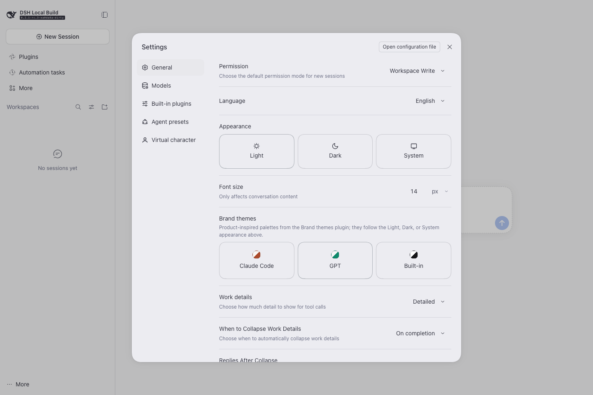
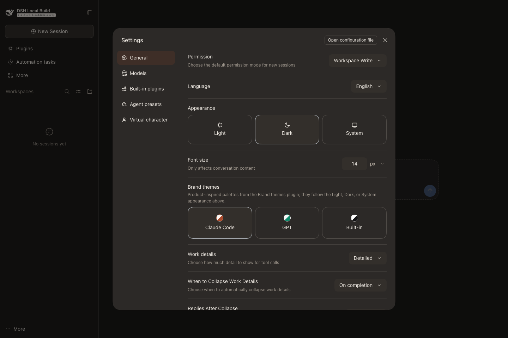
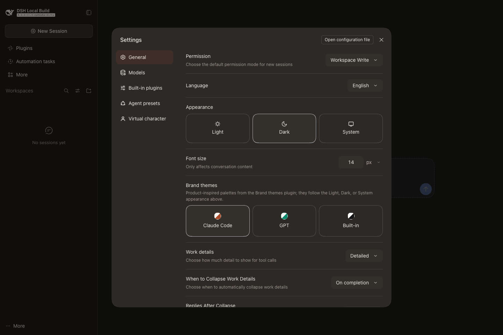

# Brand themes（品牌主题）

DeepSeek Harness Web 客户端的配色主题插件，包含两套产品风格主题：

| 主题 id | 名称 | 浅色画布 / 强调色 | 深色画布 / 强调色 |
| --- | --- | --- | --- |
| `claude-code` | Claude Code | 暖米色 `#faf8f5` / 陶土红 `#ab4a2b` | 暖炭黑 `#1b1a18` / 珊瑚橙 `#d97757` |
| `gpt` | GPT | 冷灰 `#f7f7f8` / OpenAI 绿 `#0d8a6b` | ChatGPT 炭黑 `#212121` / 绿 `#10a37f` |

每个主题都覆盖同一组 `--dsw-*` 别名 token：背景与表面层级、边框、品牌色、文字层级、代码块、气泡、侧栏等。每项 token 同时提供浅色和深色两个值，因此主题会跟随「外观」中的浅色 / 深色 / 跟随系统选择，而不是强制某一种底座配色。

## 预览

| GPT（浅色） | Claude Code（深色） |
| --- | --- |
|  |  |

## 行为

- 在 **设置 → 通用** 中新增「品牌主题」一栏，提供 `Claude Code`、`GPT`、`内置` 三个色卡（画布/强调色拼接圆盘）。点击切换到对应主题，再次点击已选中的主题，或点击「内置」，即可回到内置外观。
- 主题以 `ctx.theme.overrideTokens()` 的 token 覆盖层实现，叠在内置浅色/深色底座之上，不修改 `ui-theme` 的内置主题目录。选中或切换「外观」后立即生效，整套界面（侧栏、设置、对话、代码块、气泡）同步换色。
- 选择记录在浏览器 `localStorage`（键 `@local/dsh-theme-claude-gpt:active`），插件加载时自动恢复；同一浏览器的多个标签页会跟随切换。
- 插件被移除或禁用时覆盖层一并移除，界面立即回到内置外观；`localStorage` 被禁用时选择只在当前页面会话内有效。

## 安装与移除

插件以 bundle 形式提供：`cordis.patch.yml` 插入 Loader 行，`package.json` 的 `dsh.client` 把 `client.js` 提供给页面。

- 从本目录安装：`plugin_manager` 工具 `install_bundle`（绝对路径），或 `dsh plugin --profile <profile> add ./plugins/dsh-theme-claude-gpt`。
- 移除：`plugin_manager` `remove_bundle`，目标 `@local/dsh-theme-claude-gpt`。
- 修改 `client.js` 后需在插件页关闭再开启该 bundle（或重新安装 / 重启 Host），并刷新页面，浏览器才会加载新的模块代际。

## 实现

- `client.js` 是懒加载 CJS 工厂格式（`window.__ModuleLoader__.load`），只依赖平台模块表中的 `react`。
- `apply(ctx)` 注入 `theme`、`slots`、`locale`：注册中英文案，把色卡行注册进 `settings.general.item` 槽位，并按记忆的选择调用 `ctx.theme.overrideTokens(PLUGIN_ID, pairs)`；每个 token 的 `{ light, dark }` 取自该主题的两套调色板。
- 覆盖层按 `token → { light, dark }` 提供值，主题服务在合成当前快照时按当前配色方案取值，所以「外观」切换不需要插件参与。
- `index.js` 是空实现的 Host 半部分；bundle 需要一个可加载的 Host 入口。

## 限制

- 只覆盖别名 token，不替换产品图标、文件类型图标或品牌字形。
- 主题选择不写入 Host 设置文档（`ui-theme` 的持久化 schema 只接受内置偏好），因此按浏览器而不是按 DSH 用户保存。
- 若其他插件也调用 `overrideTokens`，各覆盖层按注册顺序叠加、后注册者逐 token 生效；本插件只处理自己 source 的层。
